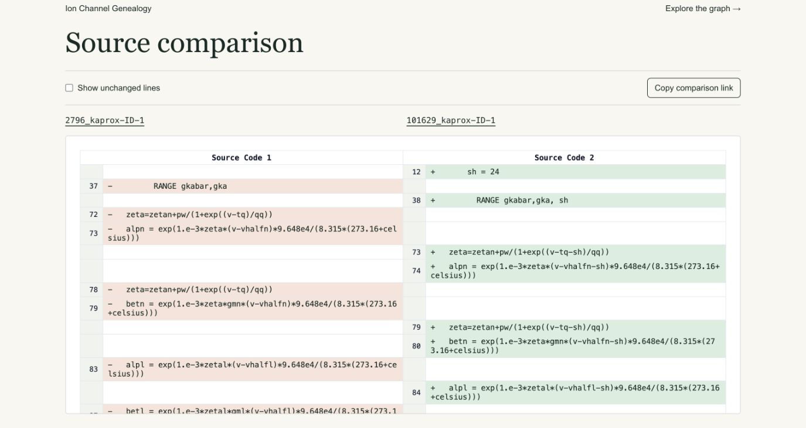

# Ion Channel Genealogy Visualizer

Explore source-code similarity across 4,820 Hodgkin–Huxley ion-channel models from [ModelDB](https://modeldb.science) and the [Ion Channel Genealogy project](https://icg.neurotheory.ox.ac.uk/).

## What changed in `kaprox.mod`?

Two potassium-channel files in ModelDB entries [2796](https://modeldb.science/2796) and [101629](https://modeldb.science/101629) score **98.75%** on the graph's Levenshtein similarity measure. The second file adds a parameter, `sh = 24`, and uses it to shift the voltage terms in the gating equations.

**[Open this comparison →](https://icg-explorer.org/compare?left=2796_kaprox-ID-1&right=101629_kaprox-ID-1)**

[](https://icg-explorer.org/compare?left=2796_kaprox-ID-1&right=101629_kaprox-ID-1)

[Explore the similarity graph](https://icg-explorer.org/visualizer) to filter by ion class, change the threshold, and compare model files. **Copy comparison link** shares the displayed pair in left–right order. The [Omnimodel library](https://icg-explorer.org/omnimodels) contains 3,524 reports with fitted parameters, steady states and time constants.

Panos Bozelos co-developed the explorer and applied source-code similarity analysis to ion-channel models in his doctoral research. The underlying model collections are credited to ModelDB and the Ion Channel Genealogy project.

## How it works

The production site is fully static: the application exports to plain files
(`npm run build:static`), and the 3,524 Omnimodel report URLs are served by a
single exported client shell — the CDN validates each requested model against
a published key list and rewrites valid URLs to the shell, so unknown models
receive a true HTTP 404 and no per-model prerender is needed. Source-code
requests accept only a strict identifier grammar. Scientific rendering is
fail-closed throughout: if data cannot be loaded and verified, the
application shows an explicit error rather than substitute content.
Source-code diffs run in a browser worker with bounded input, output, and
execution time, rendered inside a unique-origin sandbox.

The default graph loads only models meeting the initial two-copy threshold. In the measured default view, this reduced transferred graph data from 1,087,261 to 176,684 bytes (84%). Lowering the threshold loads the full graph.

Design details: [docs/ARCHITECTURE.md](docs/ARCHITECTURE.md) ·
Security model: [docs/SECURITY.md](docs/SECURITY.md)

## Development

Requires Node 22 (pinned in `package.json`).

```sh
npm ci --ignore-scripts
npm run dev            # http://127.0.0.1:3000 (loopback only)
npm run lint
npx tsc --noEmit
npm run build          # server build
npm run build:static   # static production export into out/ (verified)
```

The scientific data under `public/data/` (network graph, Omnimodel reports
and plots, shell index) is generated by the scripts in `scripts/` from the
upstream ICG/ModelDB material; regeneration commands are in `package.json`.
The Omnimodel generators accept only a regular, non-symlink
`supermodel_data.json` source capped at 32 MiB. Pickle deserialization is not
supported; input-artifact provenance must still be established before
regenerating scientific outputs.

Deployment and site operations are maintained separately and are not part of
this repository.
